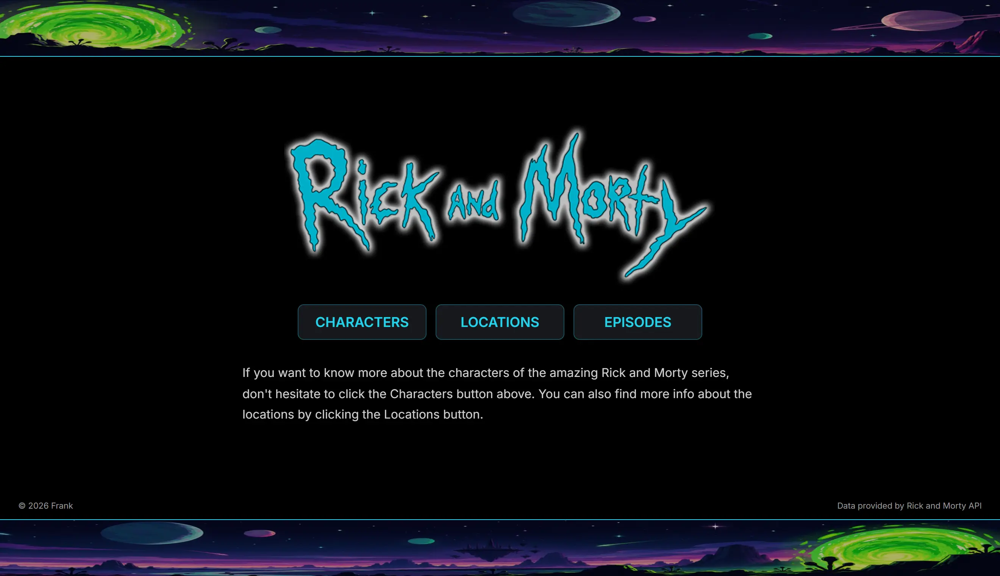
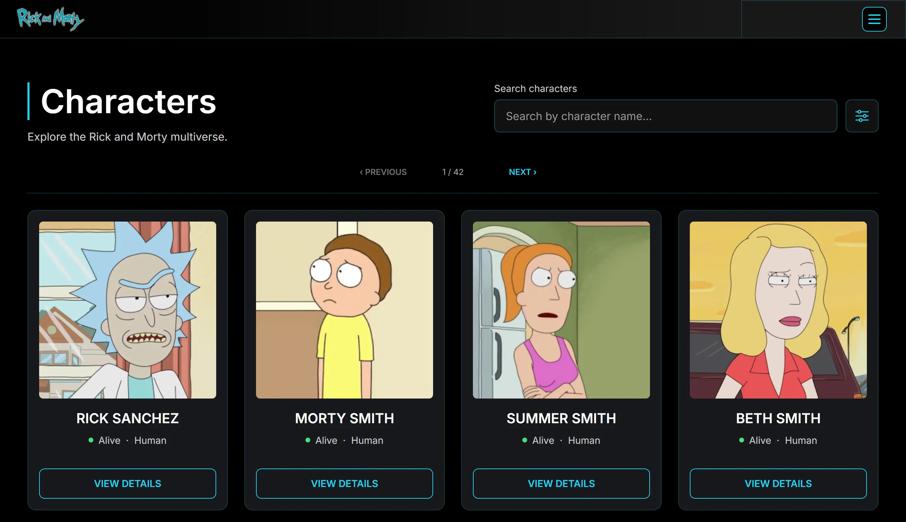
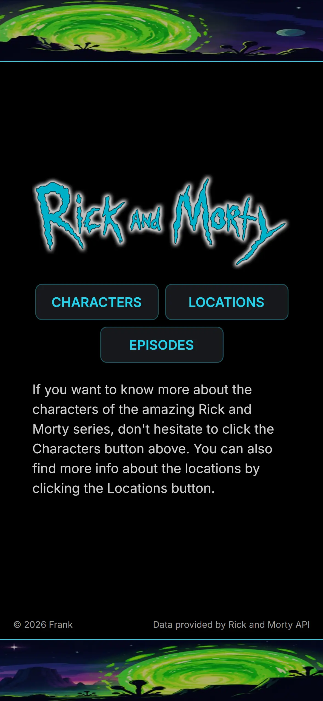
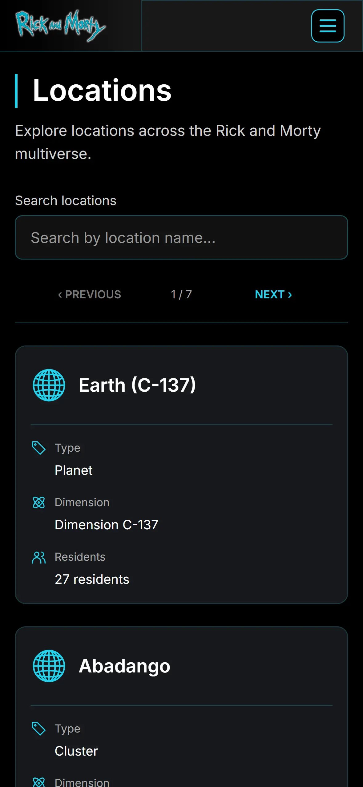

# Rick and Morty | Multiverse Explorer

**A personal React project exploring the Rick and Morty universe.**

Multiverse Explorer is a responsive web application built with React, JavaScript, Vite, and the [Rick and Morty API](https://rickandmortyapi.com/).

The project started as a rebuild of one of my earlier React applications. What began as an opportunity to revisit my old code gradually turned into something more: a chance to rethink the structure, improve the user experience, and build a more complete application from the ground up.

My goal was to keep the project simple and enjoyable to use while paying attention to the details that make a difference.

## Live Demo

**[Explore the Multiverse](https://frankom85.github.io/rick-and-morty-2026/)**

## Preview

<a href="screenshots/RM_desktop-landing.webp">
  
</a>
<a href="screenshots/RM_desktop-characters.webp">
  
</a>
<a href="screenshots/RM_mobile-landing.webp">
  
</a>
<a href="screenshots/RM_mobile-locations.webp">
  
</a>

## Features

### Characters

- Browse characters from the Rick and Morty universe.
- Search characters by name.
- Filter by status, species, and gender.
- Combine search and filters to narrow down results.
- Expand character cards to explore additional details.

### Locations

- Explore locations across the multiverse.
- Search locations by name.
- View location types, dimensions, and resident counts.

### Episodes

- Browse episodes from the series.
- Search episodes by name.
- View episode codes, air dates, and character counts.

### User Experience

- Responsive layouts for desktop, tablet, and mobile.
- Dynamic pagination based on API results.
- Debounced search with a two-character activation threshold.
- Loading, empty, and error states with retry functionality.
- Custom navigation, subtle animations, and interactive feedback.
- Keyboard accessibility, visible focus indicators, and reduced-motion support.
- Accessible focus management when navigating between sections.

### API & Performance

- Custom React hooks keep API communication separate from presentation logic.
- Request cancellation helps prevent outdated responses from affecting the interface.
- Search and filter state work together with pagination.
- Failed requests can be retried without reloading the application.

## Tech Stack

- **React** — Component-based UI and state management
- **JavaScript** — Application logic and interactions
- **Vite** — Development environment and build tooling
- **CSS** — Responsive layouts, animations, and custom design tokens
- **Rick and Morty API** — Character, location, and episode data
- **ESLint** — Code quality checks
- **GitHub Actions & GitHub Pages** — Automated build and deployment

## What I Focused On

This project was an opportunity to revisit one of my earlier React applications and apply what I have learned since then.

I wanted to rethink how I approach frontend development, especially how individual components fit together and how an application behaves beyond its initial appearance.

Some of the areas I focused on were:

- Building reusable components without adding unnecessary complexity.
- Keeping API communication separate from presentation logic.
- Managing asynchronous requests, loading states, errors, and retry behavior.
- Making search, filters, and pagination work together consistently.
- Designing responsive layouts that feel natural across different screen sizes.
- Refining small interactions, including hover states, focus behavior, and animations.
- Improving keyboard accessibility and section navigation.
- Keeping the code organized and maintainable as the application grew.

One of the more interesting challenges was making the different browsing interactions work together consistently. Search, filters, pagination, and expanded character details all needed to remain predictable as the user explored the application.

Another challenge was preserving the visual identity of the landing page while adapting the interface to smaller screens and different viewport orientations.

Working through those details became one of the most valuable parts of the project.

The result is an application that reflects both my earlier learning experience and my current approach to frontend development.

## Getting Started

To run the project locally, you'll need Node.js 24 and npm.

**1. Clone the repository**

```bash
git clone https://github.com/FrankoM85/rick-and-morty-2026.git
cd rick-and-morty-2026
```

**2. Install dependencies**

```bash
npm ci
```

**3. Start the development server**

```bash
npm run dev
```

Open the local URL shown in your terminal.

To create a production build:

```bash
npm run build
```

To preview the production build:

```bash
npm run preview
```

To run the code quality check:

```bash
npm run lint
```

## Project Structure

```text
.
├── .github/
│   └── workflows/
│       └── deploy.yml
├── public/
│   └── favicon.svg
├── screenshots/             # Portfolio screenshots
│   ├── RM_desktop-landing.webp
│   ├── RM_desktop-characters.webp
│   ├── RM_mobile-landing.webp
│   └── RM_mobile-locations.webp
├── src/
│   ├── api/                 # API endpoints and data-fetching hooks
│   │   ├── endpoints.js
│   │   ├── useFetch.js
│   │   ├── useCharacters.js
│   │   ├── useLocations.js
│   │   └── useEpisodes.js
│   ├── assets/              # Logo and landing scene images
│   │   ├── logo.png
│   │   ├── landing-scene-top.jpg
│   │   └── landing-scene-bottom.jpg
│   ├── components/
│   │   ├── LandingPage/
│   │   │   ├── LandingPage.jsx
│   │   │   └── landingPage.css
│   │   ├── Navbar/
│   │   │   ├── Navbar.jsx
│   │   │   └── navbar.css
│   │   ├── CharactersPage/
│   │   │   ├── CharactersPage.jsx
│   │   │   └── charactersPage.css
│   │   ├── CharacterCard/
│   │   │   ├── CharacterCard.jsx
│   │   │   └── characterCard.css
│   │   ├── LocationsPage/
│   │   │   ├── LocationsPage.jsx
│   │   │   └── locationsPage.css
│   │   ├── LocationCard/
│   │   │   ├── LocationCard.jsx
│   │   │   └── locationCard.css
│   │   ├── EpisodesPage/
│   │   │   ├── EpisodesPage.jsx
│   │   │   └── episodesPage.css
│   │   ├── EpisodeCard/
│   │   │   ├── EpisodeCard.jsx
│   │   │   └── episodeCard.css
│   │   ├── ResultsState/
│   │   │   ├── ResultsState.jsx
│   │   │   └── resultsState.css
│   │   └── Footer/
│   │       ├── Footer.jsx
│   │       └── footer.css
│   ├── App.jsx
│   ├── app.css
│   ├── index.css
│   └── main.jsx
├── index.html
├── package.json
├── package-lock.json
├── vite.config.js
├── eslint.config.js
├── .gitignore
└── README.md
```

## API & Credits

Character, location, and episode data is provided by the [Rick and Morty API](https://rickandmortyapi.com/).

Rick and Morty and its characters belong to their respective creators and rights holders.

This is an independent, non-commercial project created for learning and portfolio purposes.

---

**Built with curiosity, patience, and a lot of attention to detail.**
